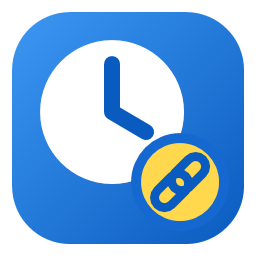

# Meet Autopilot

**Your Google Meet calls open themselves — in the right account, with the camera and microphone off.**
The app reads your Google calendars, and a few minutes before each meeting opens its Meet link in your browser — you only press «Join now».

 

The <code>meet-autopilot-&lt;version&gt;-setup.exe</code> file in the <b>Assets</b> section ·
<a href="https://github.com/vladkharitonov87/meet-autopilot-releases/releases">Release history</a>

---

> [!NOTE]
> The app's interface is available in **English** and **Russian** — choose it in **Settings → Language**
> (by default it follows Windows). The names of the settings below are given in English.

## What it does

- 📅 **Reads your calendars.** Once a day (at 07:00 by default) it reads the events of your Google accounts — as many as you connect — and builds the list of meetings for the day. A refresh button on the **Today** tab reads them again at once.
- 🚀 **Opens Google Meet by itself.** A few minutes before a meeting starts (5 by default, 0–60 in the settings) the Meet link opens in a new window of your browser, in the background, without stealing the focus of what you are doing.
- 👤 **Uses the right account.** The meeting opens under the Google account whose calendar it lives in.
- 🔇 **Keeps you muted.** The microphone and the camera are turned off on the screen before you join. Joining by itself («Join now») is a setting, off by default — otherwise joining the call is up to you.
- 🧹 **Skips what you do not need.** Declined and cancelled events, all-day events and events without a Meet link are not opened.
- 🔔 **Tells you what needs you.** Windows notifications appear when a meeting waits for the host to let you in, needs your identity check, or opens under a wrong account.
- 🧭 **Shows your day.** The **Today** tab lists the meetings with their status, and the tray menu shows the next ones.
- 🌐 **Works with Chrome or Edge.** Choose the browser in **Settings → Browser**.
- ⚙️ **Configured in the app:** read time, how early to open, browser, microphone, camera, «Join now», bringing the window to the front, start with Windows, automatic updates, light or dark theme, interface language.
- 🔒 **Keeps your data on your computer.** Settings and sign-in tokens are stored only on this PC (tokens are encrypted with Windows DPAPI); nothing is sent to any server of mine.
- 🔄 **Updates itself:** the app tells you about a new version, and one click installs it.

## Installation

1. Click **Download for Windows** above and download `meet-autopilot-<version>-setup.exe` from the **Assets** section.
2. Run the installer. It installs into `C:\Program Files\Meet Autopilot` and asks for administrator rights (UAC); if you are a standard user, Windows asks for an administrator's credentials. Shortcuts in the Start menu and on the desktop are optional checkboxes in the installer.
3. The installer is not digitally signed yet, so Windows may warn you:
   - **SmartScreen** ("Windows protected your PC"): click **More info → Run anyway**.
   - **Smart App Control** (on by default on a clean Windows 11) blocks unsigned programs without a "Run anyway" button. If it blocks the installer, the app cannot be installed while Smart App Control is on.
4. Start the app from the Start menu. It lives in the system tray, and the first-run wizard walks you through the setup.
5. Click **Sign in with Google** for each account and allow read-only access to the calendar. Google shows a notice that the app is not verified yet — choose **Advanced → Go to Meet Autopilot**.

> [!TIP]
> You can check that the file was downloaded intact by its SHA-256 checksum: every release has a
> `meet-autopilot-<version>-setup.exe.sha256` file next to the installer, and the result of
> `(Get-FileHash .\meet-autopilot-<version>-setup.exe -Algorithm SHA256).Hash` must equal the value in it.

## Requirements

| | |
|---|---|
| System | Windows 10 or 11, 64-bit; nothing else to install, the app brings its own runtime |
| Browser | Google Chrome or Microsoft Edge — chosen in the settings. The app talks to it through remote debugging: tick **Allow remote debugging for this browser instance** once at `chrome://inspect/#remote-debugging` (`edge://inspect/#remote-debugging` for Edge); the first-run wizard checks the connection and shows this address. When the browser asks «Allow remote debugging?», the app presses **Allow** for you |
| Google account | One or more; the app only reads the events of your calendars (read-only access) |
| Interface language | English or Russian — chosen in the settings |

## Updating

The app checks for new versions by itself — on start, every 6 hours, and on **Check for updates** in the tray menu.
When a new version is out, a window asks «Install it?»: the app downloads the update, verifies its checksum,
installs it and restarts itself. You can turn the automatic check off in **Settings → Update automatically**,
or update manually by installing the new version over the old one. Your settings and sign-in are kept.

What changed in each version is in the [release history](https://github.com/vladkharitonov87/meet-autopilot-releases/releases).

## Privacy

- Your calendars are read with read-only access; the events are used on your computer to build the day's list and are not sent anywhere.
- Settings and sign-in tokens are stored on your computer only, in `%AppData%\MeetAutopilot`; the tokens are encrypted with Windows DPAPI.
- The only internet access is Google (sign-in and reading the calendar) and GitHub (the update check and the download of the update). No telemetry, no accounts of mine.
- The log is stored on your computer only, in `%AppData%\MeetAutopilot\logs`.

## Uninstalling

**Windows Settings → Apps → Installed apps → Meet Autopilot → Uninstall** (Windows asks for administrator rights, UAC).
Your settings and tokens stay in `%AppData%\MeetAutopilot` — delete that folder if you no longer need them.

## Questions and bugs

Source code is private. Found a bug or have an idea? [Create an issue](https://github.com/vladkharitonov87/meet-autopilot-releases/issues).
Please attach the version (**Settings**, section Updates) and the log from `%AppData%\MeetAutopilot\logs`.

---

Meet Autopilot is an independent project not affiliated with Google. Google Meet and Google Calendar are trademarks of Google LLC.
